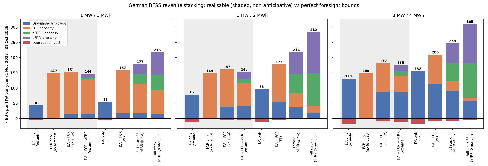
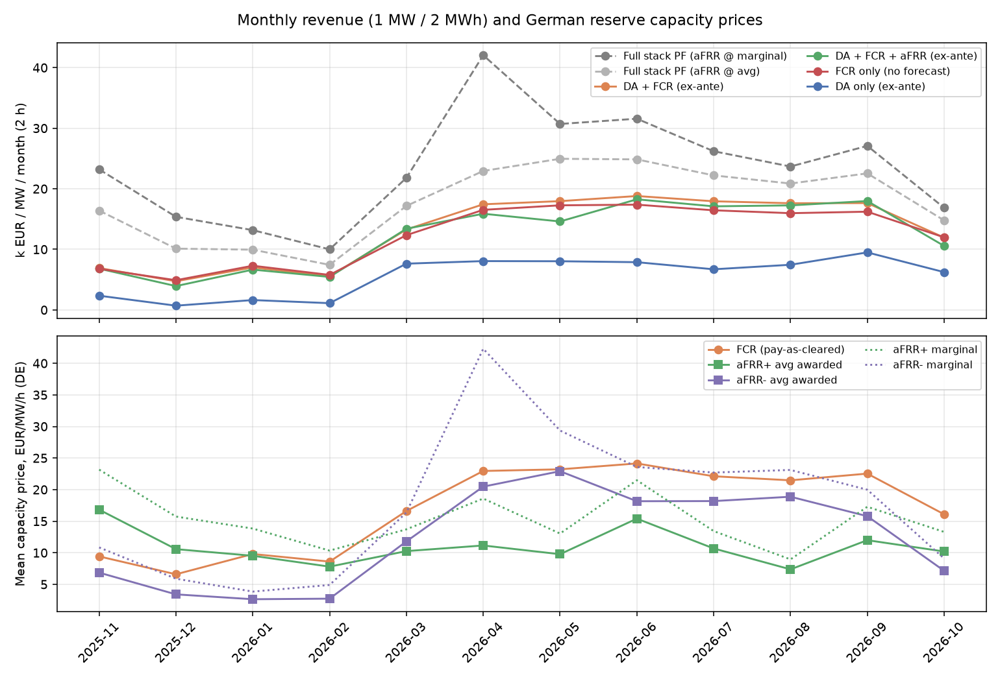
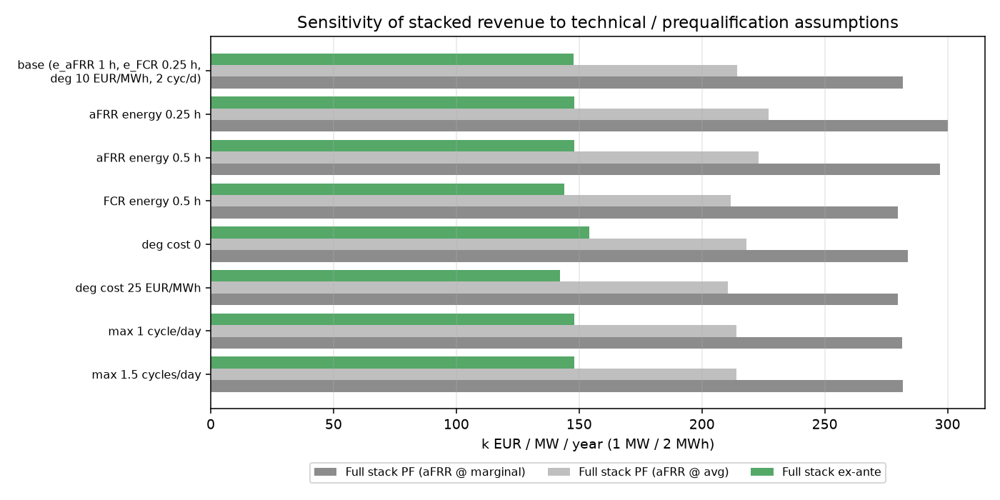

# German BESS revenue stacking: day-ahead arbitrage + FCR + aFRR

How much can a German battery earn by **co-optimising day-ahead (DA) arbitrage with FCR and aFRR
capacity**? And how much of that survives when decisions have to be made **before** prices are
known? This repo backtests one year (1 Nov 2025 to 31 Oct 2026, 365 delivery days) on **real public
data**: 15-minute DE-LU day-ahead prices and the German results of every daily FCR and aFRR
capacity auction (6 × 4-hour products a day). Each day is solved as a linear program, for
1-, 2- and 4-hour batteries.

> Results are backtests on historical prices for a hypothetical 1 MW price-taking battery.
> They are not trading results and say nothing about any real asset.



## Key results (1 MW, k EUR per MW per year, 1 Nov 2025 to 31 Oct 2026)

The first four rows only use information available at the time of each decision (shaded bars in
the figure). The last four rows are perfect-foresight (PF) upper bounds.

| Strategy | 1 h | 2 h | 4 h |
|---|---:|---:|---:|
| DA only, ex-ante (naive D-1 price forecast) | 36.4 | 67.3 | 113.6 |
| FCR only (offer full power every block, no forecast needed) | 148.9 | 148.9 | 148.9 |
| **DA + FCR, ex-ante** | **150.5** | **156.8** | **171.5** |
| DA + FCR + aFRR, ex-ante (pay-as-bid shading on 28-day history) | 144.3 | 147.9 | 164.7 |
| DA only, PF | 47.9 | 85.1 | 138.1 |
| DA + FCR, PF | 156.8 | 173.1 | 200.1 |
| Full stack, PF, aFRR paid the average awarded price | 177.0 | 214.2 | 239.4 |
| Full stack, PF, aFRR paid the marginal price (upper bound) | 215.2 | 281.7 | 305.1 |

All values are net of a 10 EUR/MWh degradation cost. Source: `results/annual_eur_per_mw.csv`, breakdown by stream in the figure.

What the year shows:

* **FCR is the backbone.** Offering the full 1 MW to FCR in every block, which needs no forecast at all,
  earned 148.9 k EUR/MW. That is 2.2× (2 h) to 4.1× (1 h) what ex-ante day-ahead arbitrage alone earned.
  FCR averaged 17.0 EUR/MW/h over the year, and from April to September 2026 it ran at 21–24 EUR/MW/h
  (figure 2).
* **Ex-ante DA + FCR is the best realisable strategy for every duration.** It earns 150.5 / 156.8 / 171.5
  k EUR/MW, which is 96 / 91 / 86 % of its own perfect-foresight bound. Arbitrage adds more as duration grows:
  +1.6 k EUR over FCR-only at 1 h, +22.6 k at 4 h.
* **aFRR holds most of the theoretical upside but none of the realised gain.** With perfect foresight,
  adding aFRR lifts the 2 h battery from 173 k to 214–282 k EUR/MW. A simple non-anticipative bidder does the
  opposite. It bids each aFRR product at the price that maximises bid × P(accepted) on the past 28 days of
  marginal prices (pay-as-bid). Only 43 % of the offered aFRR MWh were accepted (2 h). Compared with ex-ante
  DA + FCR, FCR income fell by 47.6 k EUR while aFRR brought in only 38.4 k. The full ex-ante stack therefore
  earns 6–9 k EUR/MW *less* than ex-ante DA + FCR. The likely causes, not tested separately here: acceptance
  probabilities estimated on history are optimistic, and aFRR gets chosen when the naive FCR forecast is low
  (selection bias). Capturing aFRR value is a bid-price forecasting problem, not a scheduling one.
* **Foresight losses, 2 h battery.** Of the 133.8 k EUR gap between the full PF stack (281.7 k) and the
  ex-ante stack (147.9 k), 4.5 k comes from the DA forecast (147.9 → 152.4 k with ex-ante reserves but
  perfect DA prices). The rest comes from reserve-market foresight: which product to offer, and at what bid.
* **Physical assumptions mostly change the PF bound, not the realised number** (figure 3). Shrinking the
  aFRR energy reserve from 1 h to 0.25 h raises the PF stack from 281.7 k to 300.2 k EUR/MW but leaves the
  ex-ante stack at 148 k. Degradation cost 0 → 25 EUR/MWh moves the ex-ante stack 154.1 → 142.3 k. Daily
  cycle caps of 1–2 cycles barely matter for the stacked strategies, because reserves keep throughput low
  (84–279 cycles/yr at 2 h).





## Method

### Market timing (one delivery day D)

| Time (D-1) | Market | Rule used here |
|---|---|---|
| 08:00 | FCR capacity (pay-as-cleared, symmetric, 6 × 4 h) | price-taker offer at 0 EUR/MW, always accepted, paid the German settlement price |
| 09:00 | aFRR capacity (pay-as-bid, positive/negative, 6 × 4 h) | offer accepted if bid ≤ German marginal price, paid the bid |
| 12:00 | Day-ahead auction (15-min MTU) | schedule settled at the realised DA price |

### Daily LP (`src/stack/model.py`)
Variables per 15-min step: charge `c_t`, discharge `d_t`, energy `s_t`. Per 4-h block: FCR `f_b`,
aFRR+ `u_b`, aFRR− `w_b` (MW).

* Power headroom: `d_t + f_b + u_b ≤ P` and `c_t + f_b + w_b ≤ P`
* Energy headroom, at the start and end of every step: `s ≥ E_min + e_FCR·f_b + e_aFRR·u_b` and
  `s ≤ E_max − e_FCR·f_b − e_aFRR·w_b` (`e_FCR` = 0.25 h, the 15-minute criterion; `e_aFRR` = 1 h, a
  conservative assumption; both are varied in the sensitivity runs)
* `s_t = s_{t-1} + η·c_t·Δt − d_t·Δt/η`, with RTE 88 %, SoC limits 5–95 %, and the day starting and ending at 50 %
* Throughput ≤ 2 full cycles/day. Objective = DA margin − 10 EUR/MWh × discharged energy + capacity payments
* Solved with HiGHS via `scipy.optimize.linprog`. There are 92/96/100 steps on DST days, and blocks follow local time.

### Strategies (`src/stack/backtest.py`)
* **PF (perfect foresight):** one LP with realised DA, FCR and aFRR prices. aFRR is paid either the
  marginal price (the most a pay-as-bid bidder could get, used as the upper bound) or the volume-weighted
  average awarded price (a "typical bidder" bound).
* **Ex-ante:** stage 1 decides reserves on forecasts. The DA forecast is the previous delivery day's price
  for the same quarter-hour (known before the D-1 auctions). The FCR forecast is the previous day's price
  for the same block. aFRR is valued at bid × empirical acceptance probability, with the bid chosen on the
  last 28 days of marginal prices for that block and direction. The auctions then clear on realised prices.
  Stage 2 re-optimises the DA schedule with the *accepted* reserves fixed, again on the DA forecast, and
  settles it at realised prices. `xa_stack_pfda` repeats stage 2 with realised DA prices to split
  DA-forecast losses from reserve losses.

## Data and licences
* **Day-ahead prices DE-LU, 15-min**, 1 Oct 2025 to 31 Oct 2026, from the
  [Energy-Charts API](https://api.energy-charts.info) (Fraunhofer ISE), licence **CC BY 4.0**, source
  *Bundesnetzagentur | SMARD.de*. Cached in `data/de_lu_da_15min.csv.gz` (0.2 MB).
  Mean 111.3 EUR/MWh, s.d. 67.5, 1,860 negative quarter-hours out of 35,040 in the evaluation year.
* **FCR and aFRR capacity tender results**, from the German TSOs'
  [regelleistung.net Data Center](https://www.regelleistung.net/apps/datacenter/tenders/) ("results"
  download, market CAPACITY). Fields used: the German FCR settlement capacity price (EUR/MW per 4-h
  product, divided by 4), and the German aFRR average and marginal capacity prices (EUR/MW/h).
  regelleistung.net gives **no open reuse licence**, so the raw files are **not** redistributed.
  `scripts/fetch_data.py reserve` downloads them locally (792 XLSX files, git-ignored). Only derived
  monthly means (`results/reserve_prices_monthly_mean.csv`) and model outputs are committed.
  On 28–29 Oct 2025 the files also contain a second, cross-border-only FCR tender with no German
  price; it is dropped.

## How to run
```bash
pip install -r requirements.txt
bash scripts/run_all.sh        # fetch (~5 min), backtest (~30 s on 8 cores), figures, tests
# or step by step
python scripts/fetch_data.py reserve
python scripts/run_backtest.py
python scripts/make_figures.py
python -m pytest -q            # 14 tests, synthetic inputs, no data needed
```
Outputs: `results/summary.json` (all headline numbers), `results/annual_eur_per_mw.csv`,
`results/daily_results.csv.gz` (per day × strategy × case), `results/ex_ante_reserve_allocation.csv`,
`results/sensitivity_2h.csv`. A CI example is in `docs/ci_example.yml`.

## Repository layout
```
src/stack/data.py       Energy-Charts + regelleistung.net download and parsing
src/stack/model.py      daily LP (DA + FCR + aFRR), settlement, pay-as-bid bid rule
src/stack/backtest.py   PF and ex-ante strategies over the year
scripts/                fetch, backtest + sensitivity grid, figures, run_all.sh
tests/                  14 pytest checks (energy balance, headroom, dominance, DST, parsing, PF ≥ ex-ante)
```

## Limitations
* **Activation energy is not modelled.** FCR and aFRR activations are treated as energy-neutral, so there is
  no aFRR energy-market revenue, no FCR SoC-management cost, and no imbalance cost. The energy headroom
  constraints only make delivery feasible.
* **Price-taker, 1 MW.** Offers never move clearing prices. Real portfolios and the fast-growing German BESS
  fleet do move them (German FCR demand in the evaluation-year tender files is only 528–584 MW).
* **The DA LP is a relaxation.** It allows simultaneous charge and discharge, which can occur at negative
  prices. There is no intraday market, no 15-min intraday re-optimisation, and no grid fees or levies.
* **Degradation** is a linear per-MWh cost, and SoC returns to 50 % every day (no multi-day optimisation).
* **Ex-ante forecasts are deliberately simple** (naive D-1, 28-day empirical bid). Better forecasts would
  raise the ex-ante numbers. That is the point of the PF bounds.
* **Prequalification rules are simplified** (`e_FCR`, `e_aFRR`, symmetric FCR in 4-h blocks, aFRR in 4-h
  products from the German results). Check the current TSO product terms before relying on any number.
* **One year**, on prices from an unusual year: FCR prices rose steeply in spring 2026. No inference beyond it.

## License
Code: MIT © 2026 DataWithSyed (see `LICENSE`). Day-ahead price data: CC BY 4.0, Energy-Charts /
Bundesnetzagentur | SMARD.de. regelleistung.net data are not included; their own terms apply.
