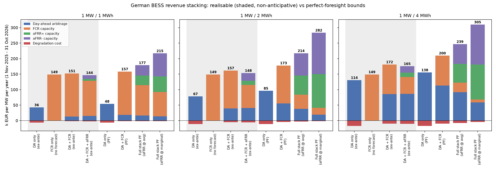
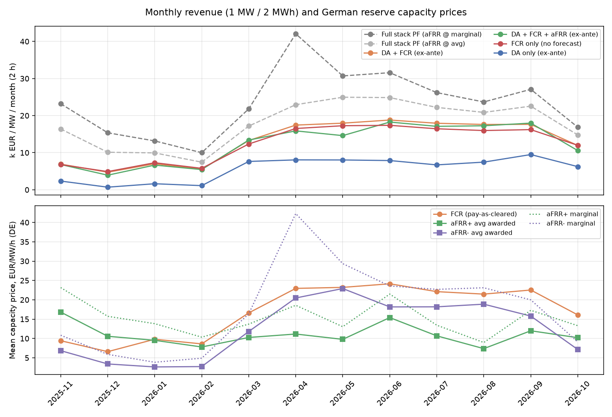
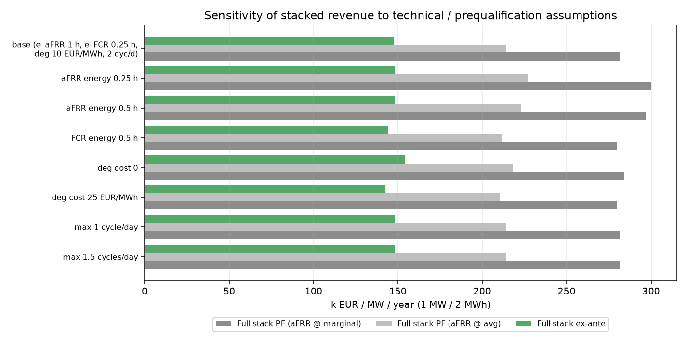
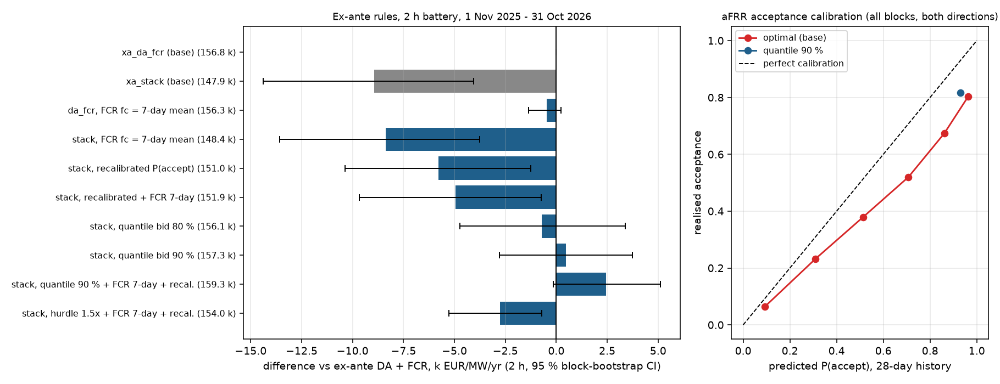
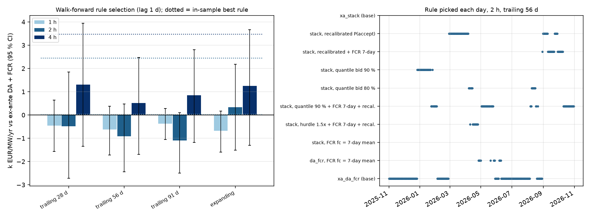

# German BESS revenue stacking: day-ahead arbitrage + FCR + aFRR

How much can a German battery earn by **co-optimising day-ahead (DA) arbitrage with FCR and aFRR
capacity**? And how much of that survives when decisions have to be made **before** prices are
known? This repo backtests one year (1 Nov 2025 to 31 Oct 2026, 365 delivery days) on **real public
data**: 15-minute DE-LU day-ahead prices and the German results of every daily FCR and aFRR
capacity auction (6 × 4-hour products a day). Each day is solved as a linear program, for
1-, 2- and 4-hour batteries.

> Results are backtests on historical prices for a hypothetical 1 MW price-taking battery.
> They are not trading results and say nothing about any real asset.



## Key results (1 MW, k EUR per MW per year, 1 Nov 2025 to 31 Oct 2026)

The first five rows only use information available at the time of each decision (shaded bars in
the figure; the calibrated-bidding row is shown in figure 4). The last four rows are perfect-foresight (PF) upper bounds.

| Strategy | 1 h | 2 h | 4 h |
|---|---:|---:|---:|
| DA only, ex-ante (naive D-1 price forecast) | 36.4 | 67.3 | 113.6 |
| FCR only (offer full power every block, no forecast needed) | 148.9 | 148.9 | 148.9 |
| **DA + FCR, ex-ante** | **150.5** | **156.8** | **171.5** |
| DA + FCR + aFRR, ex-ante (pay-as-bid shading on 28-day history) | 144.3 | 147.9 | 164.7 |
| DA + FCR + aFRR, ex-ante, calibrated bidding (90 % quantile bid, recalibrated P(accept), 7-day FCR forecast; [bidding study](#why-the-ex-ante-afrr-stack-loses-bidding-study)). Rule chosen in-sample; the gain over DA + FCR fails the [validation](#does-the-best-rule-survive-validation) | 150.5 | 159.3 | 175.0 |
| Same rule menu, picked walk-forward on trailing 56 days ([validation](#does-the-best-rule-survive-validation)) | 149.9 | 155.9 | 172.0 |
| DA only, PF | 47.9 | 85.1 | 138.1 |
| DA + FCR, PF | 156.8 | 173.1 | 200.1 |
| Full stack, PF, aFRR paid the average awarded price | 177.0 | 214.2 | 239.4 |
| Full stack, PF, aFRR paid the marginal price (upper bound) | 215.2 | 281.7 | 305.1 |

All values are net of a 10 EUR/MWh degradation cost. Source: `results/annual_eur_per_mw.csv`, breakdown by stream in the figure.

What the year shows:

* **FCR is the backbone.** Offering the full 1 MW to FCR in every block, which needs no forecast at all,
  earned 148.9 k EUR/MW. That is 2.2× (2 h) to 4.1× (1 h) what ex-ante day-ahead arbitrage alone earned.
  FCR averaged 17.0 EUR/MW/h over the year, and from April to September 2026 it ran at 21–24 EUR/MW/h
  (figure 2).
* **Ex-ante DA + FCR is the best realisable strategy of the original backtest** (the bidding study adds a
  calibrated full stack that edges past it by 0.0 / 2.4 / 3.5 k EUR/MW, but that gain fails a search-corrected
  test and walk-forward rule selection; see [validation](#does-the-best-rule-survive-validation)). It earns 150.5 / 156.8 / 171.5
  k EUR/MW, which is 96 / 91 / 86 % of its own perfect-foresight bound. Arbitrage adds more as duration grows:
  +1.6 k EUR over FCR-only at 1 h, +22.6 k at 4 h.
* **aFRR holds most of the theoretical upside but none of the realised gain.** With perfect foresight,
  adding aFRR lifts the 2 h battery from 173 k to 214–282 k EUR/MW. A simple non-anticipative bidder does the
  opposite. It bids each aFRR product at the price that maximises bid × P(accepted) on the past 28 days of
  marginal prices (pay-as-bid). Only 43 % of the offered aFRR MWh were accepted (2 h). Compared with ex-ante
  DA + FCR, FCR income fell by 47.6 k EUR while aFRR brought in only 38.4 k. The full ex-ante stack therefore
  earns 6–9 k EUR/MW *less* than ex-ante DA + FCR. The [bidding study](#why-the-ex-ante-afrr-stack-loses-bidding-study)
  below tests the two suspected causes (both confirmed) and a non-anticipative fix that turns the loss into a small gain.
* **Foresight losses, 2 h battery.** Of the 133.8 k EUR gap between the full PF stack (281.7 k) and the
  ex-ante stack (147.9 k), 4.5 k comes from the DA forecast (147.9 → 152.4 k with ex-ante reserves but
  perfect DA prices). The rest comes from reserve-market foresight: which product to offer, and at what bid.
* **Physical assumptions mostly change the PF bound, not the realised number** (figure 3). Shrinking the
  aFRR energy reserve from 1 h to 0.25 h raises the PF stack from 281.7 k to 300.2 k EUR/MW but leaves the
  ex-ante stack at 148 k. Degradation cost 0 → 25 EUR/MWh moves the ex-ante stack 154.1 → 142.3 k. Daily
  cycle caps of 1–2 cycles barely matter for the stacked strategies, because reserves keep throughput low
  (84–279 cycles/yr at 2 h).





## Why the ex-ante aFRR stack loses (bidding study)

`scripts/run_bid_study.py` and `src/stack/bidding.py` (added 8 Nov 2026) re-run the ex-ante strategy with
ten bidding/forecast rules, for all three durations and the same 365 days. Every rule uses only prices and
auction results up to D-1. The two base rules reproduce the original backtest exactly (unit test).
Differences are given against ex-ante DA + FCR, with a 95 % moving-block bootstrap CI (7-day blocks,
2,000 resamples).

**Cause 1, optimistic acceptance probabilities: confirmed.** On all 4,380 aFRR block-direction auctions,
the base rule predicted an average acceptance of 72.4 % and realised 56.7 %. It was optimistic in every
probability bin: bids it rated at 0.96 were accepted 80 % of the time, bids rated 0.71 only 52 %
(`results/bid_study_calibration.csv`, right panel below). Bidding at the 90 % quantile of the last 28 days'
marginal prices is better calibrated, but still optimistic: 93 % predicted, 82 % realised.

**Cause 2, selection bias in the FCR forecast: confirmed, but small.** In the 2 h base stack, the blocks where
stage 1 preferred aFRR to FCR had an FCR forecast 1.02 EUR/MW/h *below* the realised price on average. Blocks
that stayed in FCR had a forecast 0.74 EUR/MW/h *above* it (`results/bid_study_selection_bias.csv`).

**Fixes, 2 h battery (k EUR/MW/yr; ex-ante DA + FCR = 156.8):**

| Ex-ante rule | Total | vs DA + FCR | 95 % CI | Nov–Apr | May–Oct | aFRR acceptance |
|---|---:|---:|---|---:|---:|---:|
| Base stack (max bid × P on 28-day history) | 147.9 | −8.9 | −14.4 … −4.0 | −2.8 | −6.1 | 43 % |
| + 7-day-mean FCR forecast | 148.4 | −8.4 | −13.6 … −3.7 | −3.2 | −5.2 | 43 % |
| + P(accept) recalibrated on the last 28 days' outcomes | 151.0 | −5.8 | −10.4 … −1.3 | −1.8 | −4.0 | 38 % |
| Bid at the 90 % quantile instead | 157.3 | +0.5 | −2.8 … +3.7 | +1.7 | −1.3 | 70 % |
| **90 % quantile + recalibration + 7-day FCR forecast** | **159.3** | **+2.4** | −0.1 … +5.1 | +2.1 | +0.4 | 69 % |
| Hurdle 1.5× on aFRR value + recalibration + 7-day FCR | 154.0 | −2.8 | −5.3 … −0.7 | −1.0 | −1.8 | 35 % |

The same combined rule gives +0.0 k at 1 h (CI −1.2 … +1.2) and **+3.5 k at 4 h (CI +0.1 … +6.8)**. All
ten rules × three durations are in `results/bid_study_annual.csv`.



What this means:

* The loss in the original ex-ante stack came from **bidding**, not from the schedule. With acceptance
  probabilities calibrated against realised auctions, it disappears at every duration.
* Even so, **aFRR adds little on top of a well-run DA + FCR strategy**: +2.4 k EUR/MW at 2 h and +3.5 k at
  4 h, with CIs that touch zero. The +41–109 k EUR/MW of perfect-foresight aFRR value at 2 h (PF full stack vs PF DA + FCR) is still
  out of reach for simple history-based bidders.
* **Caveat: the rule is chosen in-sample.** Ten rules were tested on one year and the best is reported. It is
  positive in both half-years at 2 h and 4 h. The [validation below](#does-the-best-rule-survive-validation)
  checks it for data snooping and with walk-forward selection, and the gain does **not** survive.

## Does the best rule survive validation?

`scripts/run_rule_validation.py` and `src/stack/selection.py` (added 17 Nov 2026) re-use the committed daily
table of the bidding study (`results/bid_study_daily.csv.gz`, 10 rules × 3 durations × 365 days). No new
market data and no new LP runs are needed. Switching rules from day to day is valid on that table. Every rule's
day-D decision uses only market data up to D-1, its acceptance recalibration scores its own *hypothetical*
bids against published marginal prices, and the battery is back at 50 % SoC every night.

**1. Data-snooping test.** Hansen's (2005) Superior Predictive Ability test asks whether *any* of the nine
alternative rules beats ex-ante DA + FCR once the search over nine rules is accounted for (stationary bootstrap,
mean block 7 days, 2,000 resamples; `results/rule_validation_spa.csv`):

| Battery | Best rule's gain (k EUR/MW/yr) | p, best rule alone (no search correction) | p, SPA_c (corrected) | p, White Reality Check |
|---|---:|---:|---:|---:|
| 1 h | +0.0 | 0.45 | 0.66 | 0.89 |
| 2 h | +2.4 | 0.069 | 0.16 | 0.22 |
| 4 h | +3.5 | 0.034 | 0.12 | 0.13 |

With a 14-day mean block, the SPA_c p-values are 0.78 / 0.26 / 0.17. On its own, the 4 h gain looks
significant at 5 % (one-sided), which matches the bidding study's CI of +0.1 … +6.8. Once the search over
nine rules is accounted for, it is not.

**2. Walk-forward selection.** Each day, a trader picks the rule with the highest realised revenue over the
trailing window, using days up to D-1 (lag 1). Lag 2 is a conservative check. The first 28 days default to
DA + FCR (`results/rule_validation_walk_forward.csv`). Values are k EUR/MW/yr vs ex-ante DA + FCR, with a 95 %
moving-block CI:

| Trailing window | 1 h | 2 h | 4 h |
|---|---|---|---|
| 28 days | −0.5 (−1.6 … +0.6) | −0.5 (−2.7 … +1.9) | +1.3 (−1.3 … +3.9) |
| 56 days | −0.6 (−1.7 … +0.4) | −0.9 (−2.4 … +0.5) | +0.5 (−1.7 … +2.5) |
| 91 days | −0.4 (−1.1 … +0.3) | −1.1 (−2.5 … +0.1) | +0.8 (−1.2 … +2.8) |
| expanding | −0.7 (−1.6 … +0.2) | +0.3 (−1.5 … +2.2) | +1.3 (−1.3 … +3.7) |
| *in-sample best rule, fixed* | *+0.0* | *+2.4* | *+3.5* |

Lag 2 gives the same picture (2 h: −1.2 to +0.3 k; 4 h: +0.4 to +1.1 k). A walk-forward trader keeps only
15–37 % of the in-sample best rule's gain at 4 h and none at 1–2 h (except +0.3 k with an expanding window at 2 h). Every CI includes zero. Trailing windows
switch rules 20–59 times a year (figure 5, right), which is a sign of chasing noise.



**Conclusion.** The bidding study's fixes are real: the base stack's −6 to −9 k EUR/MW loss disappears under
every calibrated rule. The *gain* over DA + FCR is not robust. It does not survive a search-corrected test
or a non-anticipative rule choice. **Ex-ante DA + FCR remains the defensible realisable strategy for this
year.** On top of it, aFRR capacity is worth somewhere between −1 and +4 k EUR/MW/yr to a simple history-based
bidder, which cannot be told apart from zero. A second year of auctions would be the proper out-of-sample test.

## Method

### Market timing (one delivery day D)

| Time (D-1) | Market | Rule used here |
|---|---|---|
| 08:00 | FCR capacity (pay-as-cleared, symmetric, 6 × 4 h) | price-taker offer at 0 EUR/MW, always accepted, paid the German settlement price |
| 09:00 | aFRR capacity (pay-as-bid, positive/negative, 6 × 4 h) | offer accepted if bid ≤ German marginal price, paid the bid |
| 12:00 | Day-ahead auction (15-min MTU) | schedule settled at the realised DA price |

### Daily LP (`src/stack/model.py`)
Variables per 15-min step: charge `c_t`, discharge `d_t`, energy `s_t`. Per 4-h block: FCR `f_b`,
aFRR+ `u_b`, aFRR− `w_b` (MW).

* Power headroom: `d_t + f_b + u_b ≤ P` and `c_t + f_b + w_b ≤ P`
* Energy headroom, at the start and end of every step: `s ≥ E_min + e_FCR·f_b + e_aFRR·u_b` and
  `s ≤ E_max − e_FCR·f_b − e_aFRR·w_b` (`e_FCR` = 0.25 h, the 15-minute criterion; `e_aFRR` = 1 h, a
  conservative assumption; both are varied in the sensitivity runs)
* `s_t = s_{t-1} + η·c_t·Δt − d_t·Δt/η`, with RTE 88 %, SoC limits 5–95 %, and the day starting and ending at 50 %
* Throughput ≤ 2 full cycles/day. Objective = DA margin − 10 EUR/MWh × discharged energy + capacity payments
* Solved with HiGHS via `scipy.optimize.linprog`. There are 92/96/100 steps on DST days, and blocks follow local time.

### Strategies (`src/stack/backtest.py`)
* **PF (perfect foresight):** one LP with realised DA, FCR and aFRR prices. aFRR is paid either the
  marginal price (the most a pay-as-bid bidder could get, used as the upper bound) or the volume-weighted
  average awarded price (a "typical bidder" bound).
* **Ex-ante:** stage 1 decides reserves on forecasts. The DA forecast is the previous delivery day's price
  for the same quarter-hour (known before the D-1 auctions). The FCR forecast is the previous day's price
  for the same block. aFRR is valued at bid × empirical acceptance probability, with the bid chosen on the
  last 28 days of marginal prices for that block and direction. The auctions then clear on realised prices.
  Stage 2 re-optimises the DA schedule with the *accepted* reserves fixed, again on the DA forecast, and
  settles it at realised prices. `xa_stack_pfda` repeats stage 2 with realised DA prices to split
  DA-forecast losses from reserve losses.

## Data and licences
* **Day-ahead prices DE-LU, 15-min**, 1 Oct 2025 to 31 Oct 2026, from the
  [Energy-Charts API](https://api.energy-charts.info) (Fraunhofer ISE), licence **CC BY 4.0**, source
  *Bundesnetzagentur | SMARD.de*. Cached in `data/de_lu_da_15min.csv.gz` (0.2 MB).
  Mean 111.3 EUR/MWh, s.d. 67.5, 1,860 negative quarter-hours out of 35,040 in the evaluation year.
* **FCR and aFRR capacity tender results**, from the German TSOs'
  [regelleistung.net Data Center](https://www.regelleistung.net/apps/datacenter/tenders/) ("results"
  download, market CAPACITY). Fields used: the German FCR settlement capacity price (EUR/MW per 4-h
  product, divided by 4), and the German aFRR average and marginal capacity prices (EUR/MW/h).
  regelleistung.net gives **no open reuse licence**, so the raw files are **not** redistributed.
  `scripts/fetch_data.py reserve` downloads them locally (792 XLSX files, git-ignored). Only derived
  monthly means (`results/reserve_prices_monthly_mean.csv`) and model outputs are committed.
  On 28–29 Oct 2025 the files also contain a second, cross-border-only FCR tender with no German
  price; it is dropped.

## How to run
```bash
pip install -r requirements.txt
bash scripts/run_all.sh        # fetch (~5 min), backtest (~30 s on 8 cores), figures, tests
# or step by step
python scripts/fetch_data.py reserve
python scripts/run_backtest.py
python scripts/make_figures.py
python scripts/run_bid_study.py  # bidding study (~30 s on 8 cores, needs the fetched reserve data)
python scripts/run_rule_validation.py  # SPA test + walk-forward rule choice (~5 s, committed daily table only)
python -m pytest -q            # 23 tests, synthetic inputs, no data needed
```
Outputs: `results/summary.json` (all headline numbers), `results/annual_eur_per_mw.csv`,
`results/daily_results.csv.gz` (per day × strategy × case), `results/ex_ante_reserve_allocation.csv`,
`results/sensitivity_2h.csv`, `results/bid_study_*.csv`, `results/rule_validation_*`. A CI example is in `docs/ci_example.yml`.

## Repository layout
```
src/stack/data.py       Energy-Charts + regelleistung.net download and parsing
src/stack/model.py      daily LP (DA + FCR + aFRR), settlement, pay-as-bid bid rule
src/stack/backtest.py   PF and ex-ante strategies over the year
src/stack/bidding.py    ex-ante bidding diagnostics (calibration, selection bias) and alternative rules
src/stack/selection.py  Hansen SPA / Reality Check test and walk-forward rule selection
scripts/                fetch, backtest + sensitivity grid, figures, run_all.sh
tests/                  23 pytest checks (energy balance, headroom, dominance, DST, parsing, PF ≥ ex-ante,
                        bidding rules: non-anticipative calibration, reproduction of the base backtest;
                        walk-forward selection uses no future rows, SPA size/power)
```

## Limitations
* **Activation energy is not modelled.** FCR and aFRR activations are treated as energy-neutral, so there is
  no aFRR energy-market revenue, no FCR SoC-management cost, and no imbalance cost. The energy headroom
  constraints only make delivery feasible.
* **Price-taker, 1 MW.** Offers never move clearing prices. Real portfolios and the fast-growing German BESS
  fleet do move them (German FCR demand in the evaluation-year tender files is only 528–584 MW).
* **The DA LP is a relaxation.** It allows simultaneous charge and discharge, which can occur at negative
  prices. There is no intraday market, no 15-min intraday re-optimisation, and no grid fees or levies.
* **Degradation** is a linear per-MWh cost, and SoC returns to 50 % every day (no multi-day optimisation).
* **Ex-ante forecasts are deliberately simple** (naive D-1, 28-day empirical bid; the bidding study adds a
  7-day FCR mean and recalibrated quantile bids). Better forecasts would raise the ex-ante numbers. That is
  the point of the PF bounds.
* **Prequalification rules are simplified** (`e_FCR`, `e_aFRR`, symmetric FCR in 4-h blocks, aFRR in 4-h
  products from the German results). Check the current TSO product terms before relying on any number.
* **One year**, on prices from an unusual year: FCR prices rose steeply in spring 2026. No inference beyond it.

## References
* Hansen, P. R. (2005). A Test for Superior Predictive Ability. *Journal of Business & Economic Statistics*
  23(4), 365–380. https://doi.org/10.1198/073500105000000063
* White, H. (2000). A Reality Check for Data Snooping. *Econometrica* 68(5), 1097–1126.
  https://doi.org/10.1111/1468-0262.00152
* Politis, D. N., Romano, J. P. (1994). The Stationary Bootstrap. *Journal of the American Statistical
  Association* 89(428), 1303–1313. https://doi.org/10.1080/01621459.1994.10476870

## License
Code: MIT © 2026 DataWithSyed (see `LICENSE`). Day-ahead price data: CC BY 4.0, Energy-Charts /
Bundesnetzagentur | SMARD.de. regelleistung.net data are not included; their own terms apply.
